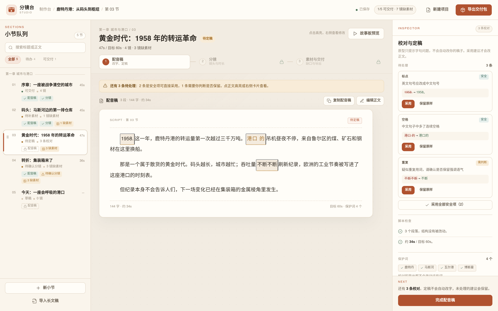

# 分镜台 Studio · v0.3.0

[**在线打开 v0.3.0 制作台**](https://compassscout.github.io/storyboard-studio/storyboard-studio-v3/)

一个**本地优先**的视频分镜与装配工作台。

当前仓库包含两版界面：

- **v0.3.0 制作台原型**：`storyboard-studio-v3/`，纯静态、零依赖，可直接打开，用来验证新的信息架构与交互；
- **v0.2.0 Electron 应用**：仓库根目录，可运行的本地应用。

## v0.3.0 制作台原型

[](https://compassscout.github.io/storyboard-studio/storyboard-studio-v3/)

直接打开 `storyboard-studio-v3/index.html` 即可，无需安装、无需联网。

一条视频就是一个制作台：

- **左侧**：这一条视频的小节队列，可按状态和关键词筛选；
- **中间**：当前小节的「配音稿 → 分镜 → 素材与交付」三步流水线；
- **右侧**：检查器与固定的「下一步」主按钮。

小节状态不再是手工勾选，而是由「正文是否定稿 / 分镜是否确认 / 素材缺口」自动推导：

- 改正文会回到「待定稿」；
- 改镜头会要求重新确认分镜；
- 采用校对建议会真的改正文，并且可撤销；
- 缺素材只提示，不阻塞交付。

交付包由前端真实生成 zip，包含：配音稿 `.txt`、分镜表 `.csv`、素材清单 `.csv`、字幕 `.srt`、项目数据 `.json`。

> 原型使用内存中的 mock 数据，刷新后恢复示例；不会写入本地文件，也不调用后端或 AI。

### 推荐体验路径

1. 默认停在「黄金时代」，点击正文高亮，逐条采用或保留校对建议；
2. 点「完成配音稿」，进入分镜，修改一个镜头时长，看它要求重新确认；
3. 在素材页把「未找到」改成「已下载」，观察缺口数量变化；
4. 打开故事板预览翻镜、播放；
5. 打开交付包，勾选文件并生成 zip；
6. 新建项目，把一篇长文稿按标题拆成小节。

## v0.2.0 应用本地运行

直接用 Chrome 打开根目录的 `index.html`，或：

```bash
npm install
npm start
```

## v0.2.0 已实现

### 项目

- 新建项目：项目名 + 原始文稿；
- 支持粘贴、导入 `.txt` / `.md`；
- 项目保存在浏览器 `localStorage`；
- 删除项目、重命名项目。

### 文稿处理

- 按标题自动拆分小节；
- 「对照 / 原稿 / 修订」三种视图；
- 右侧修改清单：安全项 / 需确认；
- 接受安全项、逐条采用 / 保留；
- 本地规则检查：连续空格、英文标点、重复字、重复标点；
- 完成定稿后，才允许进入镜头表。

### 镜头表

- 按整节文案自动生成镜头；
- 按句子长度估算镜头时长；
- 按关键词给出画面类型。

### 装配

- 本节播放器 + 本节时间线；
- 16:9 1080p 默认，可切 720p / 4K / 9:16 / 4:5 / 1:1 / 21:9 / 4:3；
- 播放器容器随尺寸变化，不是只裁画面。

### 导出

- 真实下载当前项目 CSV，可用 Excel 打开；
- 其他导出格式仍是界面演示。

## 示例内容

仓库内置三篇约 5000 字的示例文章，用于测试长文拆分、文稿处理和镜头生成：

- 《从码头到枢纽：鹿特丹港如何重塑一座城市》
- 《从纸张到屏幕：信息载体如何改变知识传播》
- 《铁轨上的腹地：一条铁路如何改写芝加哥的命运》

## 还没做

- 真实 AI 调用；
- 真实剪映 / PR 工程；
- 多集 / 多章完整管理；
- 大模型级校对和素材搜索。

## 版本

- v0.3.0：制作台原型（`storyboard-studio-v3/`）
- v0.2.0：Electron 应用（仓库根目录）
