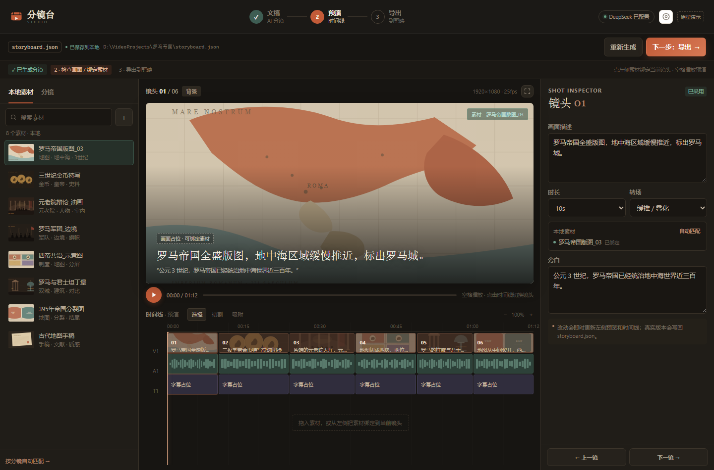

# 分镜台 Studio

一个**文稿驱动**的视频装配台原型：把文稿拆成可审核的镜头表，绑定本地素材，粗剪预演，再导出初稿给剪映 / Premiere / Kdenlive。

当前仍是**界面原型**：不调用真实 AI、不读写本地文件、不生成真实工程文件。



## 在线看界面

- 网页演示：<https://compassscout.github.io/storyboard-studio/>
- GitHub：<https://github.com/compassscout/storyboard-studio>

## 桌面版

当前 release 里的 Windows 便携版还是 **v0.1.0 旧界面**。  
这次迭代先更新网页和源码，桌面安装包稍后重新打包。

- [查看 Releases](https://github.com/compassscout/storyboard-studio/releases)

## 从源码运行

需要 Node.js 20+。

```bash
npm install
npm start
```

Windows 也可以双击 `start.cmd`（前提是已经 `npm install`）。

> 如果终端里设置了 `ELECTRON_RUN_AS_NODE=1`，Electron 会以 Node 模式启动而报错。  
> 用 `start.cmd` 或先执行 `set ELECTRON_RUN_AS_NODE=` 再 `npm start`。

## 当前界面逻辑

### 1. 文稿 → 镜头表

- 新建项目，先确定画幅、帧率、目标时长、旁白来源；
- 粘贴文稿，选择输出目录；
- AI 设置收进设置弹窗，不再占用主流程；
- 生成镜头表后，先审核，再进入装配。

### 2. 镜头审核 → 装配

- 左侧默认是**镜头表**：镜头号、叙事作用、时长、素材状态、采用状态；
- 素材库单独一个 Tab，支持视频/图片/音频筛选；
- 右侧检查器分成**镜头 / 画面片段 / 声音**三栏；
- 时间线显示 V1 主画面、A1 旁白、T1 字幕；
- 顶部有审核进度、撤销/重做、自动保存状态；
- 底部状态栏显示分辨率、帧率、轨道和时长。

### 3. 导出初稿

- 先选目标：素材包、剪映草稿、XML / EDL / MLT；
- 再设范围、目标软件、分辨率、帧率、输出目录；
- 导出前检查缺失素材、未采用镜头、旁白、目录可写；
- 剪映草稿明确标为实验，不装作官方能力。

## 当前可点击

- 步骤切换；
- 修改项目名；
- 生成镜头表（模拟）；
- 镜头采用 / 需要修改 / 批量采用；
- 镜头表 / 素材库切换；
- 素材类型筛选、搜索；
- 检查器三栏切换；
- 时间线切换镜头、空格播放；
- 素材绑定、自动匹配；
- 导出目标选择、导出前检查、导出按钮（模拟）；
- 设置弹窗、API 服务切换。

## 还没做

- 真实 DeepSeek API；
- 本地文件读写；
- 真实素材扫描与预览；
- 真正的撤销/重做和自动保存；
- 多片段、多轨和音频对齐；
- 任何真实工程导出。

## 技术形态

- Electron 桌面壳；
- 原生 HTML / CSS / JavaScript，无需构建；
- 没有后端、数据库或真实文件访问。

## 许可

MIT
