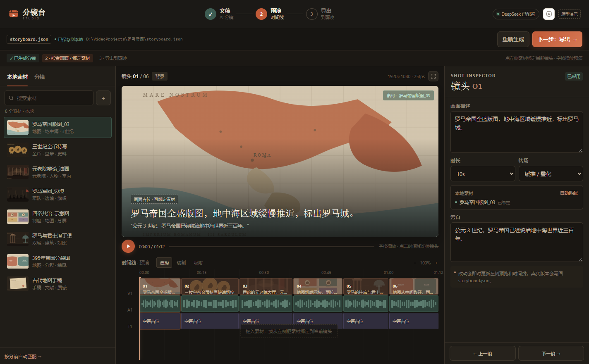
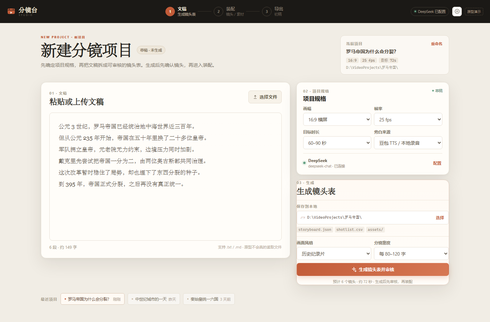
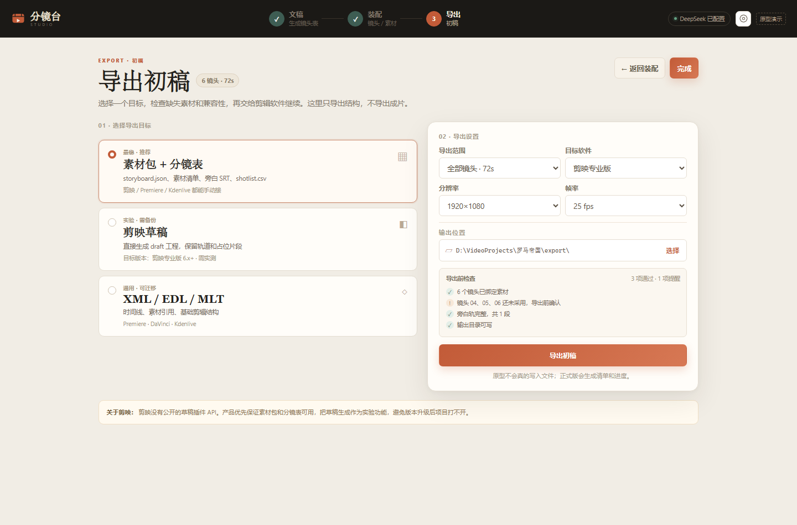

# 分镜台 Studio

一个**文稿驱动**的视频创作工作台原型：从文稿生成分镜，进入预演时间线，绑定本地素材，最后导出给剪映 / Premiere / Kdenlive。

当前是**桌面界面原型**，不调用真实 AI、不读写本地文件、不生成真实工程文件。



## 在线看界面

- 网页演示：<https://compassscout.github.io/storyboard-studio/>
- GitHub：<https://github.com/compassscout/storyboard-studio>

## 直接运行（Windows 便携版）

如果你不想装 Node.js，直接下载便携版：

[下载 Storyboard Studio v0.1.0 Windows x64（约 159 MB）](https://github.com/compassscout/storyboard-studio/releases/download/v0.1.0/storyboard-studio-v0.1.0-win-x64.zip)

解压后双击 `StoryboardStudio.exe`。  
Windows 可能提示“未知发布者”，这是因为应用还没有代码签名，选择“更多信息 → 仍要运行”即可。

## 从源码运行

需要 Node.js 20+。

```bash
npm install
npm start
```

Windows 也可以双击 `start.cmd`（前提是已经 `npm install`）。

> 如果终端里设置了 `ELECTRON_RUN_AS_NODE=1`，Electron 会以 Node 模式启动而报错。  
> 用 `start.cmd` 或先执行 `set ELECTRON_RUN_AS_NODE=` 再 `npm start`。

## 三步流程

### 1. 文稿 → AI 分镜

- 粘贴/上传文稿；
- 配置 DeepSeek API（目前是假数据）；
- 选择本地保存目录（目前是模拟）；
- 生成带画面描述、时长、搜索词的分镜脚本。

### 2. 预演 → 绑定素材

- 类似剪辑软件的时间线；
- 每个镜头先用文字描述占位；
- 播放预演、切换镜头；
- 从左侧素材库绑定到当前镜头；
- 修改画面描述、旁白、时长、转场。

### 3. 导出

- **素材包 + 分镜表**：推荐，最稳；
- **剪映草稿**：实验，剪映没有公开草稿 API；
- **XML / EDL**：给 Premiere / DaVinci 等工具。






## 当前可点击的界面逻辑

- 步骤切换；
- 生成分镜（模拟）；
- 选择输出目录（模拟）；
- 测试 DeepSeek API（模拟）；
- 设置弹窗；
- 时间线切换镜头；
- 空格播放/暂停；
- 素材绑定；
- 素材/分镜 Tab；
- 修改画面描述、旁白、时长；
- 上一镜/下一镜；
- 画布全屏；
- 导出按钮（模拟）。

## 技术形态

- Electron 桌面壳；
- 原生 HTML / CSS / JavaScript，无需构建；
- 当前没有后端、没有数据库、没有真实文件访问。

## 下一步（还没做）

1. 接入 DeepSeek API，生成真实分镜 JSON；
2. 选择本地目录并保存 `storyboard.json`；
3. 扫描本地素材、缩略图和绑定；
4. 真实音频/视频预览；
5. 导出 MLT XML / FCPXML / EDL；
6. 最后再评估剪映草稿和 PR 工程。

## 许可

MIT
